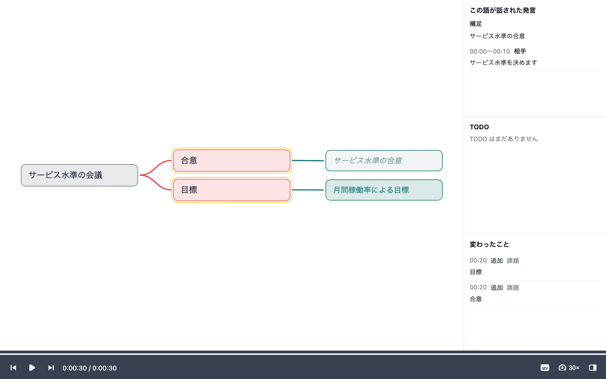
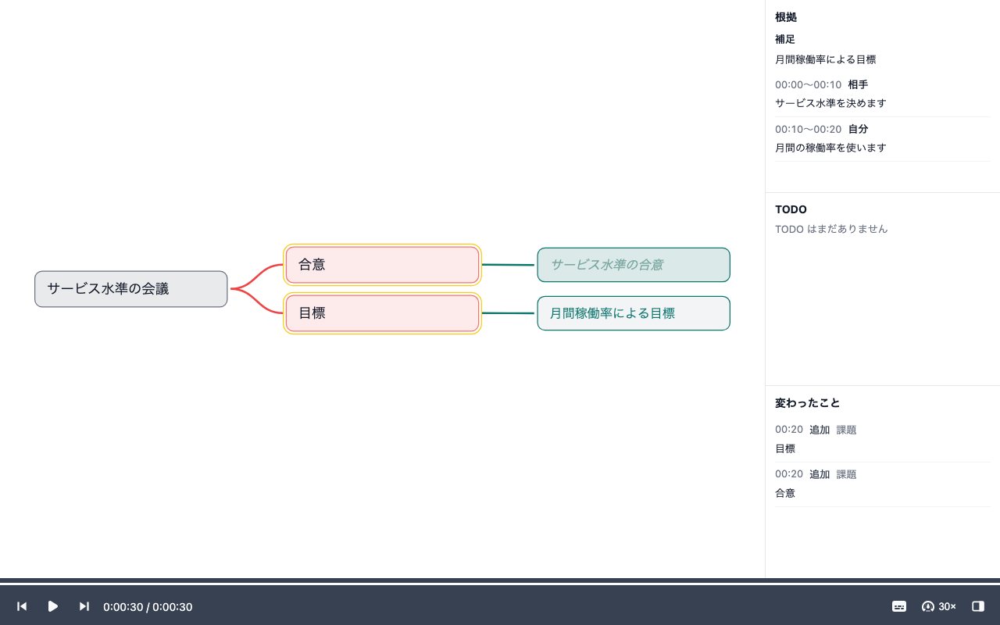

# Issue #1771 の書き出し確認

補足を含む同じ合成セッションから、現在の実装で `map.html` と Markdown を生成した。実セッションは使用していない。

対象は [Issue #1771](https://github.com/daiki-beppu/live-mindmap/issues/1771) の実装報告への提出義務（`final-gate-001`）。生成に使ったソースは `7108a16b3c2ea2195a42640e6e7c114570adee86`。ソース・テスト・README・lockfile は変更していない。

## HTML の写し

生成した `map.html` を Chromium 153.0.8010.12 で直接開き、30 秒の最終状態を撮影した。画像は 1280 × 800、deviceScaleFactor は 1。両補足と「合意」「目標」への接続を読める。

外部補足「サービス水準の合意」を選択した状態。斜体・薄色で表示され、右列には「この語が話された発言」が出る。



内部補足「月間稼働率による目標」を選択した状態。通常の文字で表示され、右列には「根拠」が出る。



撮影時の computed style は外部補足が `italic` / `rgb(123, 168, 161)`、内部補足が `normal` / `rgb(15, 118, 110)`。両方とも `boxShadow: none`、マーク数は 0。ページの JavaScript エラーは 0 件だった。

## Markdown の該当箇所

生成した [map.md](map.md) のアウトラインをそのまま引用する。

```markdown
## アウトライン
- 合意（00:00）
  - サービス水準の合意（会議の外）（00:00）
- 目標（00:00）
  - 月間稼働率による目標（会議の中）（00:00）
```

## 生成条件

[capture.json](capture.json) にソース版、runtime、lockfile・入力・生成物・画像の SHA-256、表示時刻と観測したスタイルを保存した。[log.jsonl](log.jsonl) は既存の `server/test/fixtures/supplement.ts` の `supplementLog("SLO", ["r2"])` が返した 7 行の合成ログ。HTML と Markdown はともにこのログを入力にしている。

生成環境は Node v26.13.0、pnpm 12.11.2、playwright-core 1.63.0。リポジトリルートで `pnpm install --frozen-lockfile` を実行した。Chromium は次の既存スクリプトで隔離して導入した。

```sh
LIVE_MINDMAP_DEPS="$PWD/.takt/issue-1771-deps" pnpm --filter @live-mindmap/server deps:install chromium
```

合成ログを `.takt/issue-1771-session/log.jsonl` へ保存し、次の既存 CLI で HTML を生成した。

```sh
pnpm --filter @live-mindmap/server cli review "$PWD/.takt/issue-1771-session"
```

Markdown は同じログを読み、既存の公開関数で生成した。

```js
const events = readFileSync('.takt/issue-1771-session/log.jsonl', 'utf8')
  .trim().split('\n').map(JSON.parse);
const snapshot = reviewSnapshot(events);
const markdown = exportFiles(toJsonExport(snapshot, snapshot.remarks))['map.md'];
```

`readFileSync` は `node:fs`、ほかの関数は `server/src/core/index.ts` から読み込んだ。撮影は生成 HTML の `file://` URL を開き、内部補足の表示を待ってから、各補足をクリックして根拠欄の表示を待ち、Playwright の `page.screenshot` で取得した。DOM・CSS・埋め込みログは撮影用に変更していない。ブラウザーは取得後に閉じた。

元の HTML は `.takt/issue-1771-session/map.html` に後続確認用として保持している。このローカルパスを GitHub 添付とは扱わない。GitHub で確認する提出物は、このディレクトリに保存した画像・Markdown・生成条件・合成入力であり、後続の push と PR 記録の工程で同じファイルを参照する。

## 今回の確認結果

| 確認 | 結果 |
|------|------|
| lockfile に固定した依存の導入 | 成功 |
| 既存 CLI による HTML 生成（実 Vite ビルド） | 成功 |
| 同じ入力からの Markdown 生成 | 成功 |
| Chromium での表示・撮影と画像の目視 | 成功。補足と添付先を読める |
| Markdown 抜粋・画像参照・ハッシュの照合 | 成功 |

この修正は提出物の補完のみ。今回 `pnpm typecheck`・`pnpm test`・`pnpm test:it`・E2E smoke は実行していない。PR 全体の各検証層の結果を、この確認結果で代替しない。Drawnix 実アプリ読込と Cloudflare 実公開も行っていない。
