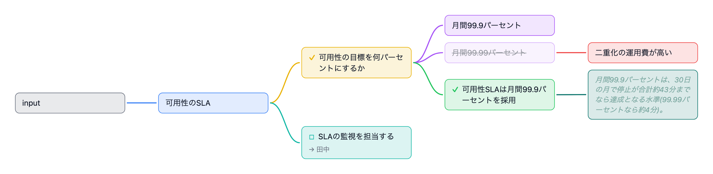

# Issue #1774の補足生成

4発言の[合成会議](input.transcript.json)を、固定モデル`claude-sonnet-5-5`、`--judge off`で再生した。Claudeの実際の応答から差分4行と補足1行が記録され、補足は追加1件だった。発言の本文はログから検査せず、行の種類と操作を集計した。



画像右側の薄色・斜体のノードが、月間99.9%の停止時間を説明する補足。CLIが書き出した`map.png`をそのまま保存し、接続先と本文を目視確認した。画像は補足の出力例であり、意味判断の一般的な品質や全受入条件を証明するものではない。

## 再生条件

Node v26.13.0、pnpm 12.11.2。管理依存はworktree内の専用ディレクトリへ導入した。認証済みのClaudeを使い、APIキーは指定しなかった。

```sh
LIVE_MINDMAP_DEPS="$PWD/.takt/1774-managed" pnpm --filter @live-mindmap/server deps:install claude chromium
env -u ANTHROPIC_API_KEY \
  LIVE_MINDMAP_DEPS="$PWD/.takt/1774-managed" \
  LIVE_MINDMAP_SESSIONS="$PWD/.takt/1774-synthetic-sessions-companion" \
  LIVE_MINDMAP_CONFIG="$PWD/.takt/1774-empty-config.json" \
  LIVE_MINDMAP_PORT=0 \
  pnpm --filter @live-mindmap/server cli play "$PWD/docs/screenshots/issue-1774/input.transcript.json" --model claude --judge off
```

`1774-empty-config.json`は存在しない設定ファイルを指定している。モデルの応答は実行ごとに変わる。[capture.json](capture.json)に実行条件、行数、入力と画像のSHA-256を記録した。
